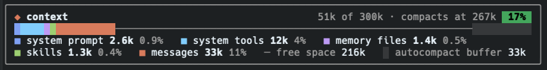

# ctx-bar

A Claude Code plugin that shows what is filling your context window, as a stacked bar above the prompt.



- One color per category, in the same order as `/context` (system prompt, tools, MCP tools, memory files, skills, messages), then free space and the auto-compact buffer.
- The header shows total tokens, the window size, where auto-compaction runs, and a percentage badge that turns yellow at 70% and red at 90% of the compaction point.
- The legend lists each category's tokens and its share of the window.

## Install

Clone the repo and load it for one session:

```sh
git clone https://github.com/Shaurya-Sethi/ctx-bar
claude --plugin-dir ./ctx-bar
```

## Usage

The bar appears when a session starts. Run `/context-bar` to hide or show it. Your choice persists across sessions.

The bar is not drawn when the terminal is too narrow (under 20 columns inside the box) or while a survey is showing. Other plugins that render above the prompt still render.

## How it works

- Token counts come from the same breakdown `/context` uses, estimated locally. Refreshing makes no API calls.
- The bar refreshes when the main conversation adds a row (prompt, response, tool result), when a turn ends, and after `/clear`, `/compact`, `/resume` or auto-compaction. Subagent activity is ignored, because subagents use their own context windows.
- After a transcript swap, refreshes run on short timers (up to 2s) because the host has no event for when the swap finishes. A very large `/resume` can leave the bar stale until the next message.
- Managed settings may block the auto-compaction hook. If so, the bar updates on the next reply instead.

## Development

```
.claude-plugin/plugin.json   manifest
hooks/hooks.json             module list
hooks/register.tsx           hooks, rendering, and the pure helpers (toReading, cells, legend, tokens, share)
types/index.d.ts             Reading and Slice types
tests/context-bar.test.tsx   tests
```

`tsconfig.json` extends `.claude-plugin/types/tsconfig.json`, which the Claude Code host provides and this repo does not include. Get the host tooling before you typecheck.

```sh
claude plugin validate .
claude plugin test .
```

Issues are tracked at [Shaurya-Sethi/ctx-bar](https://github.com/Shaurya-Sethi/ctx-bar/issues).
